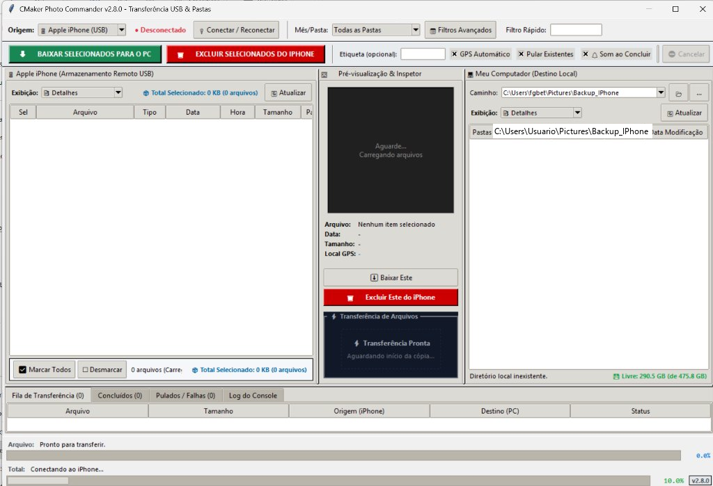

# 📱📁 CMaker Photo Commander



Aplicação desktop completa e utilitário de linha de comando em Python (versão atual **`v2.8.0`**, exibida de forma permanente no título da janela e no canto direito da barra de status inferior) com **interface multi-pane redimensionável e divisórias persistentes**, projetada para navegar, visualizar miniaturas, baixar, organizar e **excluir fotos e vídeos diretamente de um iPhone conectado via USB ou de qualquer diretório local (pastas no PC, cartões SD de câmeras, pen drives ou discos externos)**.

Todas as transferências organizam os arquivos automaticamente em pastas no padrão:

$$\text{AAAA-MM-DD[-Local]}$$

*(Exemplos: `2026-05-31-Curitiba`, `2026-05-31-Viagem` ou simplesmente `2026-05-31`)*

---

## 🌟 Principais Recursos

- **Persistência Completa de Janela e Divisórias da Interface (Sashes):**
  - **Posição e Dimensão na Tela:** Salva as coordenadas exatas da janela (`LARGURAxALTURA+X+Y`) e o estado (`normal` ou `zoomed`), reabrindo sempre na mesma posição do monitor onde você a deixou.
  - **Divisórias Horizontais (3 Colunas):** Memoriza no [config.json](file:///e:/IAGenMaster/2026/CMaker/Projetos/10-BaixarFotosIPhone/config.json) as posições dos separadores entre Origem (iPhone/Local), Painel de Pré-visualização/Vídeo e Destino (PC Local).
  - **Divisória Vertical (Painel Superior vs. Abas Inferiores):** Separador móvel (`paned_v`) que permite ajustar a altura da fila de transferência/console, mantendo o ajuste memorizado para as próximas sessões.

- **Vídeos Animados Alternados Aleatoriamente da Pasta `anim/`:**
  - **Múltiplos Vídeos com Alternância Dinâmica:** O aplicativo carrega dinamicamente todos os vídeos presentes na pasta `anim/`. Ao iniciar cada download e a cada término de vídeo em execução contínua, o sistema sorteia aleatoriamente o próximo vídeo a ser exibido, alternando sem repetições consecutivas.
  - **100% Silencioso e Leve:** Reprodução sem áudio, fluida e com baixo uso de CPU. O enquadramento se ajusta automaticamente à resolução original de cada vídeo sem distorções de aspecto.
  - **Reprodução Exclusiva Durante a Cópia:** A animação só passa quando a transferência de arquivos estiver em andamento (`_is_transferring = True`). Em estado ocioso ou pausa, o monitor permanece parado em repouso elegante sem consumo de recursos (0% de CPU).
  - **Telemetria Sobreposta:** Exibe a taxa de transferência em tempo real (MB/s) sobreposta no rodapé do player.

- **Animação Visual Fluida Durante o Carregamento de Arquivos:**
  - **Zero Áreas em Branco Estáticas:** Enquanto o sistema varre pastas locais, extrai metadados EXIF ou lê o DCIM do iPhone, a área central exibe automaticamente uma animação fluida com spinner rotativo circular a ~28 FPS.
  - **Acompanhamento Dinâmico em Tempo Real:** Indicador de progresso indeterminado e texto contextual com pontinhos dinâmicos (`.`, `..`, `...`) informando a pasta ou arquivos sendo processados naquele instante.
  - **Transição Suave:** Ao término da leitura, a animação se recolhe automaticamente e dá lugar instantâneo à tabela de arquivos ou à grade de miniaturas selecionada.

- **Resolução de Conflitos e 'Fazer isso para todos os arquivos' 100% Funcional:**
  - **Zero Popups Repetitivos do Windows:** Ao encontrar arquivos que já existem na pasta de destino, o aplicativo intercepta previamente a colisão e impede que o Windows Explorer abra caixas de confirmação nativas arquivo por arquivo.
  - **Pular Existentes Silencioso:** Quando a opção **"Pular Existentes"** está ativada na barra de ferramentas, arquivos já presentes no destino são pulados instantaneamente e registrados na aba *Pulados / Falhas*, sem nenhuma interrupção.
  - **Diálogo Próprio de Conflito com Decisão em Lote:** Caso o usuário deseje decidir o que fazer, o aplicativo exibe uma janela clara com detalhes do arquivo de origem e destino, opções de **`Substituir`**, **`Pular / Ignorar`** e **`Cancelar`**, e um checkbox **`☑ Fazer isso para todos os arquivos (aplicar aos próximos conflitos)`**. Ao marcar essa opção, a decisão é memorizada e executada para todos os arquivos restantes da transferência, sem novas perguntas.
  - **Sobrescrita Segura:** Se o usuário escolher substituir, o arquivo anterior de destino é removido em Python antes da cópia, garantindo que o Windows Shell copie diretamente sem exibir telas de confirmação.

- **Ordenação Interativa ao Clicar nos Cabeçalhos das Colunas (Estilo Explorer):**
  - **Origem (iPhone / Pasta Local):** Clique em qualquer cabeçalho de coluna para ordenar:
    - **`Sel`**: Ordena colocando os itens marcados com `[☑]` no topo ou no final.
    - **`Arquivo`**: Ordenação alfanumérica natural (*natural sort* idêntica ao Windows Explorer, onde `IMG_2` vem antes de `IMG_10`).
    - **`Tipo`**: Agrupa por formato/extensão (`JPG`, `HEIC`, `MOV`, `MP4`, `PNG`).
    - **`Data` & `Hora`**: Ordenação cronológica precisa por timestamp da captura.
    - **`Tamanho`**: Ordenação numérica real por bytes (não apenas alfabética por texto formatado).
    - **`Pasta Origem`**: Agrupa e ordena pelas subpastas de origem.
  - **Destino (Meu Computador):** Clique em **`Pastas` (`#0`)**, **`Arquivo`**, **`Tamanho`** ou **`Data Modificação`** para reordenar instantaneamente as pastas ou os arquivos internos.
  - **Feedback Visual Claro:** Alternância imediata entre crescente (**`▲`**) e decrescente (**`▼`**).
  - **Sincronismo com Grade:** A ordem definida na tabela é replicada imediatamente nos modos de **Miniaturas** e **Miniaturas Gigantes**.

- **4 Modos de Visualização Idênticos ao Windows Explorer (Em Ambos os Painéis):**
  - **`📑 Detalhes`:** Tabela completa com colunas de seleção, nome do arquivo, extensão/tipo, data, hora, tamanho e pasta de origem.
  - **`📄 Lista`:** Visualização compacta e limpa, expandindo o nome dos arquivos e ocultando colunas secundárias para visualização rápida.
  - **`🖼️ Miniaturas`:** Grade fluida com cartões (~115x165 px) e miniaturas de ~90x90 px, **botão de seleção posicionado diretamente na base de cada card (`☑ Selecionado` / `☐ Marcar`)** para não obstruir a foto, e **barra de ações na base do painel (`☑ Marcar Todos` / `☐ Desmarcar`)**.
  - **`🔍 Miniaturas Gigantes`:** Grade ampla com cartões (~215x270 px) e miniaturas em alta resolução (~180x180 px), com o botão de seleção também na base inferior de cada card.

- **Apenas 2 Botões de Atualizar Dedicados nos Visualizadores:**
  - O botão geral de atualizar foi removido da barra de ferramentas superior (`toolbar`), mantendo a interface limpa e organizada.
  - **1 Botão `🔄 Atualizar` na Origem (`btn_refresh_orig`):** Posicionado diretamente na barra de controles do topo do visualizador da Origem, atualiza os arquivos do iPhone ou da pasta local ativa.
  - **1 Botão `🔄 Atualizar` no Destino (`btn_refresh_dest`):** Posicionado na barra de controles do topo do visualizador do Destino, atualiza a árvore de pastas e arquivos locais salvos no computador.
  - Total de **apenas 2 botões de atualizar** no aplicativo inteiro, cada um operando em seu próprio painel.

- **Origem Dupla e Flexível com Simetria Dual-Pane:**
  - **`📱 Apple iPhone (USB)`:** Conexão nativa via Windows Shell COM (MTP/WPD), sem necessidade de iTunes ou drivers adicionais. Conta com o botão dedicado **`🔌 Conectar / Reconectar`** com diagnóstico inteligente via WMI que detecta se o aparelho está fisicamente conectado na USB mesmo com a tela bloqueada no iOS, orientando o usuário com precisão.
  - **`📁 Pasta / Disco Local`:** Permite selecionar qualquer pasta no computador, cartão SD de câmera digital ou pen drive. Ao selecionar pasta local, **a barra de caminho situa-se diretamente no topo do painel esquerdo, acima da janela com os arquivos, espelhando perfeitamente a barra de caminho do destino**. Conta com histórico de pastas recentes (`recent_source_paths`), botões de navegação (`...` e `📂`), varredura recursiva de mídias e leitura de metadados EXIF.
  - **Pipeline Multi-thread Thread-Safe & Carregamento Imediato:** Comunicação desacoplada via fila `ui_queue` (`_safe_call`), garantindo que o escaneamento de milhares de fotos em segundo plano ocorra de forma fluida sem congelar a tela nem disparar exceções de thread.
  - **Limpeza Visual Imediata em Transições (`_clear_orig_list`):** Ao mudar de pasta, reconectar o iPhone, trocar a origem ou atualizar, a lista visual anterior (tabela e miniaturas) é instantaneamente apagada, garantindo que nenhum item antigo permaneça visível enquanto os novos arquivos são varridos.
  - **Filtro de Período Desacoplado:** O filtro de intervalo de datas só restringe a busca se o usuário ativar expressamente o checkbox *"Ativar Filtro por Intervalo de Datas"* na janela de filtros avançados, garantindo que fotos de qualquer ano e mês sejam imediatamente encontradas e exibidas na íntegra.

- **Layout Dual-Pane Clássico:**
  - **Lado Esquerdo (Origem Remota ou Local):** Exibe todas as fotos e vídeos da origem selecionada com ícones visuais (📷 para foto, 🎬 para vídeo), tamanho, data, pasta de origem e caixas de seleção perfeitamente sincronizadas entre modos tabela e grade.
  - **Seleção em Lote Não-Destrutiva e Botões na Base:** Permite marcar todos os arquivos desejados com as caixas de seleção `[☑]` no modo tabela ou pelos **botões de seleção na base de cada card** no modo grade. Conta também com os botões **`☑ Marcar Todos`** e **`☐ Desmarcar`** estrategicamente situados na **base do painel de arquivos selecionáveis**. Clicar em qualquer linha ou cartão para inspecionar a miniatura fotográfica mantém todas as caixas marcadas intactas.
  - **Exibição do Tamanho Total dos Arquivos Selecionados:** Informa em destaque azul o volume acumulado dos arquivos marcados (`📦 Total Selecionado: X.X MB/GB (N arquivos)`), visível tanto no topo do painel esquerdo quanto em sua barra inferior, recalculado instantaneamente a cada seleção, filtro ou alteração de lote.
  - **Download e Organização em Lote Completo:** Ao clicar em **"⬇️ BAIXAR / ORGANIZAR SELECIONADOS"**, todos os arquivos marcados com `[☑]` são transferidos integralmente e organizados no destino em pastas por data e local GPS.
  - **Painel Central (Miniaturas & Inspetor):** Exibe a **miniatura real (thumbnail)** da foto ou vídeo selecionado em tempo real, acompanhada de resolução, data, tamanho e cidade identificada por GPS reverso.
  - **Lado Direito (Local / Meu Computador):** 
    - **Histórico dos Últimos Caminhos Utilizados:** A barra de caminho local é uma caixa de seleção (*Combobox*) que armazena e lista os últimos diretórios utilizados (`recent_paths`).
    - **Navegação em Pastas ou Grade:** Permite inspecionar os arquivos já salvos tanto em árvore quanto em grade de miniaturas, com duplo clique para abrir diretamente no visualizador padrão do Windows.
    - **Monitor de Espaço em Disco Livre em Tempo Real:** O rodapé do painel de destino exibe o espaço livre e o total do volume selecionado (`💾 Livre: X.X GB (de Y.Y GB)`), com cores dinâmicas de alerta (verde para espaço confortável, âmbar para < 10 GB e vermelho para < 2 GB), atualizado instantaneamente a cada arquivo copiado com sucesso e ao alterar o caminho.
  - **Painel Inferior (Fila de Transferência):** Abas para *Fila de Arquivos*, *Transferências Concluídas*, *Pulados / Falhas* e *Log do Console* com respostas de comandos em tempo real.

- **Botão de Exclusão Realçado com Fundo Vermelho e Confirmação Única:**
  - O botão **"🗑️ EXCLUIR SELECIONADOS"** possui destaque visual em **fundo vermelho vivo** (`#cc0000`), alertando sobre a natureza crítica da ação.
  - **Sem Confirmações Repetitivas Arquivo por Arquivo:** Você confirma a exclusão apenas uma vez no aplicativo. No iPhone, o interceptador em segundo plano (*Win32 Dialog Watcher*) confirma e fecha automaticamente os popups do Windows Explorer; em pastas locais, a exclusão é efetuada diretamente pelo sistema de arquivos.
  - **Remoção em Tempo Real da Tela:** Cada arquivo apagado com sucesso desaparece instantaneamente da lista visual, sem necessidade de aguardar uma nova varredura.

- **Tratamento Inteligente de Espaço em Disco e Cópia Contínua de Arquivos Grandes (7GB+):**
  - **Zero Timeouts Artificiais:** O monitoramento de cópia acompanha o crescimento real de arquivos de qualquer tamanho (incluindo gravações de 7 GB, 10 GB ou vídeos 4K pesados) sem cortes arbitrários de tempo, eliminando paradas prematuras.
  - **Gravação Direta sem Duplicação de Armazenamento:** Mídias pesadas são gravadas diretamente no destino final sem etapas intermediárias em pastas temporárias, poupando gigabytes de espaço no disco.
  - **Alerta Proativo de Disco Cheio:** Antes e durante as transferências, o sistema avalia o espaço livre na unidade de destino (`shutil.disk_usage`). Caso o espaço livre seja insuficiente para gravar o arquivo completo (ou se o disco esgotar durante a escrita):
    - O arquivo corrompido/incompleto é removido imediatamente para proteger a integridade do disco.
    - O evento é registrado com destaque no **Log do Console** e na aba **Pulados / Falhas**.
    - A interface abre o diálogo modal **⚠️ Espaço em Disco Insuficiente**, oferecendo opções para **`⏸️ Pausar Transferência`** (permitindo que você libere espaço no PC, esvazie a lixeira e clique em `▶️ Continuar` na barra de ferramentas para tentar novamente o mesmo arquivo sem perder o lote) ou **`⛔ Cancelar Transferência`**.

- **Barra Dupla de Progresso no Rodapé (Por Arquivo e Total):**
  - **Progresso Individual por Arquivo (`pbar_file`):** Exibe o nome do arquivo atualmente em transferência, volume de dados transferido e tamanho total em bytes (ex: `IMG_2048.MOV (18.4 MB / 85.2 MB)`), barra de progresso individual de 0% a 100% e porcentagem com precisão decimal (`var_file_pct_label`).
    - *Modo Local:* Transferência binária de alto desempenho em chunks de 512 KB com telemetria fluida.
    - *Modo iPhone (USB):* Monitoramento ativo de crescimento em disco do arquivo durante a cópia MTP/WPD via Shell COM.
  - **Progresso Geral do Lote (`pbar_total`):** Exibe a contagem total de arquivos transferidos sobre o total do lote (ex: `12/50 arquivos`), taxa de velocidade em tempo real (MB/s), estimativa precisa de tempo restante (ETA no formato `MM:SS`), barra de progresso total de 0% a 100%, porcentagem acumulada e badge oficial com a versão da aplicação (`v2.8.0`).
  - **Limpeza e Redefinição Inteligente:** Ambas as barras e seus rótulos são limpos e reiniciados automaticamente ao trocar de pasta, reconectar, cancelar ou concluir lotes de cópia.

- **Etiqueta Temporária Não-Persistente:**
  - O campo de texto na barra de ferramentas chama-se **`Etiqueta (opcional):`** e é a única informação propositalmente não persistida no arquivo de configurações.
  - É automaticamente limpo e apagado ao término de qualquer transferência ou sempre que você alterar de pasta (seja na origem local, no filtro de mês do iPhone ou no diretório de destino), evitando que etiquetas antigas contaminem novos lotes de fotos.

- **Controle Dinâmico de Pausa e Cancelamento com Restauração Total:**
  - **`⏸️ Pausar` / `▶️ Continuar`:** Botão comutador na barra de ferramentas que suspende momentaneamente a cópia ou exclusão de mídias em lote, congelando o vídeo animado com aviso `⏸️ PAUSADO` na tela central, sem perder os arquivos já transferidos. Clicar novamente retoma o fluxo exatamente de onde parou.
  - **`⛔ Cancelar` com Restauração Completa da Situação Inicial:** Aborta imediatamente o processo ativo em segundo plano, remove arquivos incompletos do destino ou do staging evitando corrupção, interrompe a animação de vídeo, desmarca a fila de transferências remanescente como *Cancelado*, reabilita instantaneamente os botões de ação (**Baixar** e **Excluir**), reseta ambas as barras de progresso (`0.0%`) e exibe aviso informativo sem disparar falsos alertas de conclusão.

- **Som de Conclusão Comutável (Notificação Sonora):**
  - Opção **"🔔 Som ao Concluir"** na barra de ferramentas para ativar ou desativar o aviso sonoro do Windows ao finalizar downloads ou exclusões.

---

## 🔒 Análise de Segurança & Proteção de Credenciais

Antes de publicar este repositório no GitHub, uma **auditoria completa de segurança** foi executada em todos os módulos e arquivos:

1. **Varredura de Segredos e Chaves de API:**
   - O código-fonte não contém senhas, tokens de autenticação, segredos ou chaves privadas (*zero hardcoded secrets*).
   - O acesso ao iPhone é feito 100% de forma local através das APIs nativas do Windows (`win32com` / Shell COM MTP/WPD) e WMI de hardware, sem credenciais de nuvem ou login externo.
   - A geocodificação reversa utiliza a API pública e aberta do OpenStreetMap Nominatim em conformidade com as diretrizes de User-Agent.

2. **Prevenção de Vazamento de Caminhos e Dados Pessoais:**
   - O arquivo local [config.json](file:///e:/IAGenMaster/2026/CMaker/Projetos/10-BaixarFotosIPhone/config.json) armazena os últimos caminhos de pastas selecionados pelo usuário em seu computador (por exemplo: diretórios pessoais de fotos). Para evitar o vazamento desses caminhos privados no GitHub, o `config.json` foi inserido no `.gitignore`.
   - Um arquivo de modelo limpo e seguro foi criado: [config.example.json](file:///e:/IAGenMaster/2026/CMaker/Projetos/10-BaixarFotosIPhone/config.example.json), que acompanha o repositório como padrão universal.
   - O arquivo de cache de coordenadas GPS (`scripts/geo_cache.json`) e pastas de backup com fotos baixadas (`2026-*/`, etc.) também estão protegidos pelo `.gitignore`.

3. **Proteção Contra Limite de 100 MB do GitHub:**
   - Binários compilados (`CMakerPhotoCommander.exe` de ~170 MB, pastas `build/` e `dist/`) excedem o limite de 100 MB por arquivo do GitHub.
   - O `.gitignore` bloqueia o envio acidental desses arquivos gigantes para o Git, orientando a distribuição de executáveis e instaladores exclusivamente através da aba **Releases** do GitHub.

---

## 💻 Como Usar

### 1. Opção 1: Instalador Oficial para Clientes (Recomendado)
Para instalar o programa em qualquer computador cliente sem precisar de Python ou configurações:
1. Baixe o instalador oficial: **`Instalador_CMakerPhotoCommander_v2.8.0.exe`** (disponível na aba *Releases* do GitHub).
2. Dê um duplo clique e avance pelo assistente de instalação.
3. O instalador criará automaticamente os atalhos na Área de Trabalho e no Menu Iniciar, com suporte a desinstalação padrão pelo Painel de Controle do Windows.

> Para o manual ilustrado e detalhado para usuários finais, consulte:
> 👉 **[Manual Completo de Instruções de Uso (INSTRUCOES_DE_USO.md)](file:///e:/IAGenMaster/2026/CMaker/Projetos/10-BaixarFotosIPhone/INSTRUCOES_DE_USO.md)**

### 2. Opção 2: Executável Standalone Portátil
Se preferir não rodar instalador, basta baixar o executável standalone **`CMakerPhotoCommander.exe`** ou dar duplo clique em **`iniciar_app.bat`**. Ele é 100% autônomo e portátil, pronto para rodar direto de um pen drive.

### 3. Opção 3: Execução a Partir do Código-Fonte (Desenvolvedores)
Para rodar ou modificar o projeto em ambiente de desenvolvimento Python:
```powershell
pip install -r requirements.txt
python scripts/app_gui.py
```

### 4. Como Compilar o Executável e o Instalador:
- **Compilar o Executável Standalone (.exe):**
  - Execute: `python scripts/build_exe.py` ou dê duplo clique em `scripts/build_exe.bat`.
- **Compilar o Instalador Oficial Windows (Setup):**
  - Execute: `python scripts/build_installer.py` ou dê duplo clique em `scripts/build_installer.bat`.
  - O instalador será gerado em: `dist/Instalador_CMakerPhotoCommander_v2.8.0.exe`.

---

## 🚀 Como Enviar o Projeto para o GitHub com Segurança

Para publicar o projeto em seu repositório no GitHub:

```powershell
# 1. Inicialize o repositório git local (se ainda não inicializou)
git init

# 2. Adicione os arquivos respeitando o .gitignore de segurança
git add .

# 3. Verifique os arquivos que serão versionados (garanta que .exe e config.json NÃO estão listados)
git status

# 4. Crie o primeiro commit seguro
git commit -m "feat: release CMaker Photo Commander v2.8.0 com instalador oficial e protecao de seguranca"

# 5. Conecte ao seu repositório remoto no GitHub
git branch -M main
git remote add origin https://github.com/SEU_USUARIO/NOME_DO_REPOSITORIO.git

# 6. Envie o código
git push -u origin main
```

> [!TIP]
> **Como disponibilizar o Instalador no GitHub:**
> No GitHub, acesse a aba **Releases** do seu repositório, clique em **Create a new release**, defina a tag `v2.8.0` e faça o upload de `dist/Instalador_CMakerPhotoCommander_v2.8.0.exe` e `CMakerPhotoCommander.exe`. Assim, seus clientes podem baixar o instalador com um único clique!

---

## 📁 Estrutura de Arquivos

```text
10-BaixarFotosIPhone/
│
├── .gitignore                           # Proteção contra vazamento de credenciais, dados pessoais e binários
├── config.example.json                  # Modelo padrão limpo de configurações (seguro para o Git)
├── iniciar_app.bat                      # Atalho para inicialização imediata
├── requirements.txt                     # Dependências para execução via código-fonte
├── README.md                            # Visão geral, arquitetura e análise de segurança
├── INSTRUCOES_DE_USO.md                 # Manual de instruções passo a passo para o usuário final
├── README_IA.md                         # Contexto executivo e mapa canônico para IA
│
├── anim/                                # Vídeos animados reproduzidos durante transferências
│   ├── gemini_generated_video_76520ec5.mp4
│   ├── gemini_generated_video_7b48f753.mp4
│   └── gemini_generated_video_89b51487.mp4
│
├── assets/                              # Recursos gráficos da aplicação
│   └── app_icon.ico                     # Ícone oficial multi-resolução da aplicação
│
└── scripts/                             # Pasta dedicada de scripts (Skill organizar-scripts)
    ├── app_gui.py                       # Interface Gráfica v2.8.0 (Multi-Splitter, Vídeo e Persistência)
    ├── app_cli.py                       # Interface de Linha de Comando com suporte a --delete
    ├── iphone_manager.py                # Gerenciador Shell COM WPD, thumbnails e exclusão
    ├── geo_utils.py                     # Leitor de GPS EXIF/ISO 6709, geocodificação e cache
    ├── build_exe.py                     # Script de compilação PyInstaller standalone
    ├── build_exe.bat                    # Script em lote para recompilação rápida do .exe
    ├── build_installer.py               # Script de compilação Inno Setup do Instalador oficial
    ├── build_installer.bat              # Script em lote para recompilação rápida do Instalador
    └── installer.iss                    # Definição formal do Inno Setup para Windows
```
```
